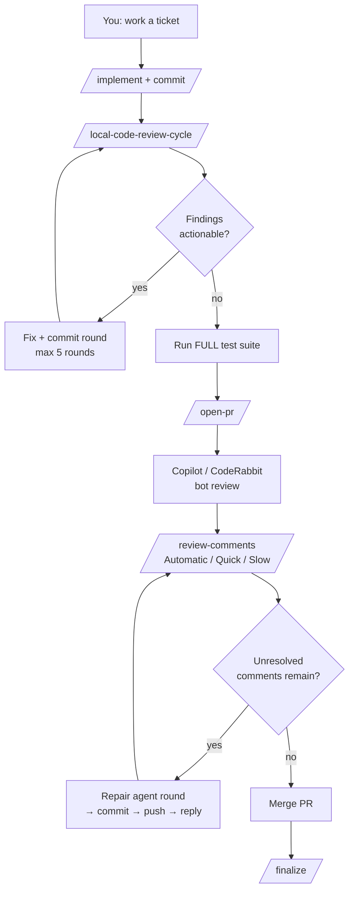
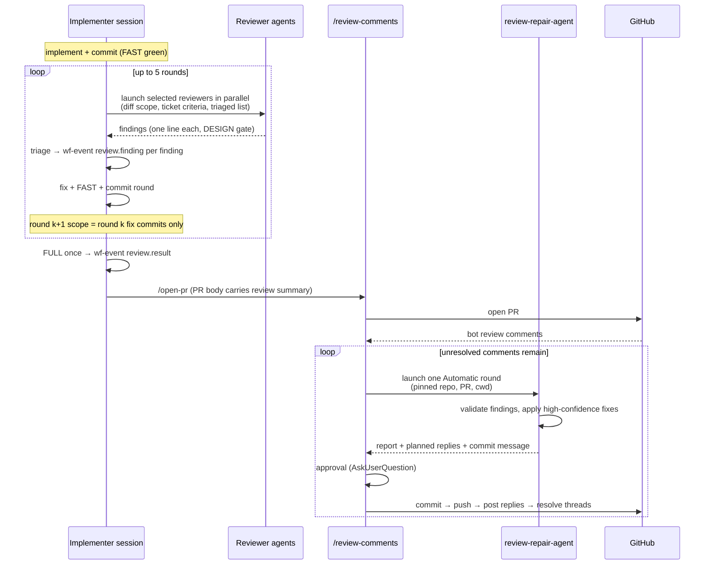
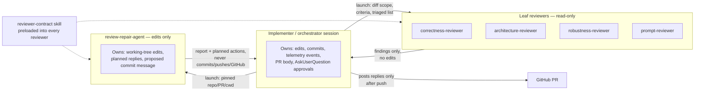

# Workflow & Review Architecture

State as of #40 and #46 (2026-10). **Keep this current:** any change to the dotfiles workflow — commands, agents, skills, hooks, or the scripts behind them — must check whether this document needs updating.

## Flow: where review happens

```
implement → commit → /local-code-review-cycle → /open-pr → bot review → /review-comments → /finalize
```

Local review runs **before** the PR, on committed local fixes; `/review-comments` handles findings **after** the PR opens. The implementer never reviews its own work — both paths use fresh, read-only agents.



## Files and why each is an agent, command, or skill

| File | Kind | Why |
|---|---|---|
| `commands/local-code-review-cycle.md.tmpl` | Command (.tmpl) | User entry point; orchestrates the whole cycle. Machine-conditional via `is_work`. |
| `agents/{correctness,architecture,robustness,prompt}-reviewer.md` | Agent | Fresh, isolated context; read-only leaf reviewers. |
| `agents/review-repair-agent.md` | Agent | Fresh context with edit tools; never commits/pushes/writes to GitHub. |
| `skills/reviewer-contract/SKILL.md` | Skill | Shared contract loaded into every reviewer; avoids per-agent duplication. |
| `skills/review-comments-procedure/SKILL.md` | Skill | 3-mode procedure loaded by the command and repair agent; not user-invocable. |
| `commands/review-comments.md` | Command | Routes mode, launches agent, owns commits and GitHub writes. |
| `commands/prompt-audit.md` + `skills/prompt-review/` | Command + skill | Corpus-level prompt rubric; runs through `prompt-reviewer`. |
| `tools/wf-event.sh`, `tools/wf-report.sh`, `tools/lib/telemetry.sh` | Script | Telemetry: one event per triaged finding, one per cycle. |
| `tools/agent-phase.sh`, `review-state.sh` | Script | Statusline bookkeeping (`[REVIEW]` etc.); no review logic. |

## Patterns

1. **Risk-based selection.** Each reviewer's `description` ends with a `Use when:` clause; the orchestrator matches clauses against `git diff --name-only BASE...HEAD` and risk signals. Smallest set that covers the risks; no code reviewer on prompt-only diffs; deterministic issues go to formatter/linter/tests.
2. **Shrinking rounds.** Round 1 reviews `BASE...HEAD`; round k+1 reviews only round k's fix commits plus a correctness pass on touched files.
3. **Evidence bar + triage.** Findings need a credible failure path, test gap, or material design cost. Already-triaged findings pass forward; nothing is resurrected without new evidence.
4. **Gates and caps.** `DESIGN: unsound` halts before code changes; max 5 rounds; `FAST` per round, `FULL` once at finish; `--confirm-commits` (default on where `is_work`).
5. **Isolation of side effects.** Reviewers read-only; repair agent edits only; commands own commits and all GitHub writes. Planned GitHub replies are posted only after the parent pushes.
6. **Measured.** Every triaged finding → `wf-event.sh review.finding`; cycle end → `review.result`. `wf-report.sh` shows which reviewers earn their tokens.

## Commands: what to use when

| Situation | Command |
|---|---|
| Non-trivial change committed, pre-PR | `/local-code-review-cycle` (auto-invoked by CLAUDE.md after ticket implementation) |
| PR opened, bot comments arrived | `/review-comments` → Automatic (agent round), Quick (one agent turn), Slow (ask me per comment) |
| Review of the prompt corpus itself | `/prompt-audit`, `/prompt-review` |
| Merged | `/finalize` |

## Agent invocation sequence



## Ownership and output visibility



Key invariant: outputs always flow **up** to the parent, which owns every irreversible action (commit, push, GitHub write). Children never talk to each other or to GitHub.

## Machine- and project-specific extensions

- **Machine:** the cycle is a `.tmpl` branching on `is_work` (e.g. `--confirm-commits` default on at work). Machine behavior lives in templates and `is_*` data, never in agent bodies.
- **Project reviewers:** agent-format file ending in a `Use when:` clause, in the repo's `.claude/agents/` (precedence over global); reference it from the project's `CLAUDE.md`.
- **Personal, work-machine reviewers for shared repos:** `docs/local/reviewers/*.md` — globally gitignored, symlinked into every worktree by `wm`. No work content in dotfiles.
- **New reviewer:** follow `reviewer-contract`'s authoring convention and cite it from project docs; the orchestrator must never invent reviewers mid-cycle.
