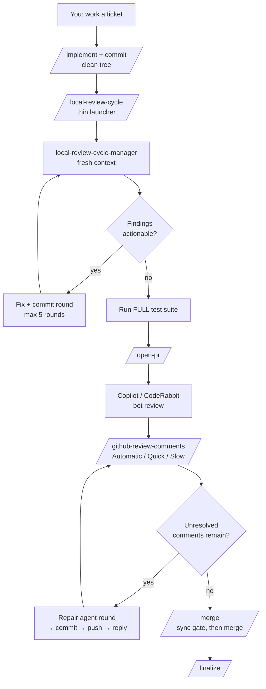

# Workflow & Review Architecture

State as of 2026-10. **Keep this current:** any change to the dotfiles workflow — commands, agents, skills, hooks, or the scripts behind them — must check whether this document needs updating.

## Flow: where review happens

```
implement → commit → /local-review-cycle → /open-pr → bot review → /github-review-comments → /merge → /finalize
```

Local review runs **before** the PR, on committed local fixes; `/github-review-comments` handles findings **after** the PR opens. The implementer never reviews its own work — orchestration itself runs in a fresh `local-review-cycle-manager` agent, so the implementing session's history never reaches the cycle either. Leaf reviewers stay fresh, read-only contexts.



## Files and why each is an agent, command, or skill

| File | Kind | Why |
|---|---|---|
| `commands/local-review-cycle.md` | Command | Thin launcher: verifies a clean tree, pins BASE/ticket/flags, launches the manager. No cycle logic. |
| `agents/local-review-cycle-manager.md` | Agent | Fresh context that orchestrates the whole cycle — selects reviewers, triages, fixes, commits each round locally; never pushes. |
| `skills/local-review-cycle-procedure/SKILL.md` | Skill | The cycle procedure (preflight, selection, triage, telemetry, report); loaded by the command and manager; not user-invocable. |
| `agents/pr-reviewers/pr-reviewer-{correctness,architecture,robustness,prompt}.md` | Agent | Fresh, isolated context; read-only PR/diff leaf reviewers (`pr-reviewer-*`). |
| `agents/pr-reviewers/pr-reviewer-{security,supply-chain}.md` | Agent | Read-only security PR/diff leaf reviewers — code-level vulnerabilities and build/config risk, selected by `use_when:` like the rest. |
| `skills/security-review-rubric/SKILL.md` | Skill | OWASP-anchored rubric preloaded into both security reviewers; usable directly for interactive checks. Separate from the built-in `/security-review`, which stays as the interactive whole-branch pass. |
| `agents/github-review-repair-agent.md` | Agent | Fresh context with edit tools; never commits/pushes/writes to GitHub. |
| `skills/reviewer-contract/SKILL.md` | Skill | Shared contract loaded into every `pr-reviewer-*` agent; avoids per-agent duplication. |
| `skills/review-lens-contract/SKILL.md` | Skill | Contract for periodic project-review lenses (`project-lens-*`, snapshot-scoped, not diff-scoped) and their discovery rules; mirrors `/local-review-cycle` tiers. |
| `commands/project-review.md` | Command | Thin launcher for periodic project review: resolves repo, default branch, and cwd, then launches `project-review-manager` and prints its report unaltered. |
| `agents/project-review-manager.md` | Agent | Fresh read-only orchestrator for periodic project review: activity gate, shared snapshot, tracker pull with truncation abort, lens fan-out, central synthesis, inline report, and cleanup. |
| `skills/project-review-procedure/SKILL.md` | Skill | Periodic project-review procedure loaded by `project-review-manager`; not user-invocable. |
| `agents/project-lenses/project-lens-triage.md` | Agent | Periodic `Lens: triage` agent: duplicates, ticket-state consistency, tech-debt priority, work clusters. Reads tickets only through `tracker.sh list`; proposes actions as text and never edits a ticket. |
| `tools/tracker.sh`, `tools/start-ticket-providers/*.sh` (`provider::list_issues`) | Script | Read-only tracker listing for lenses: JSON with a `truncated` flag; exit 2 when the provider cannot list (Shortcut is stubbed), so callers fall back to report-only. No write subcommands. |
| `tools/pending-actions.sh`, `tools/lib/pending_actions.py` | Script | Pending-actions file protocol: markdown table keyed `(issue, action)`, upsert replaces in place so reruns never duplicate a queued action. Queues only; the apply step (#137) executes. |
| `agents/project-lenses/project-lens-{architecture,quality,docs,plan}.md` | Agent | Global `Lens: collect` lenses for the periodic project review. Read-only; scope, probes and doc roles come from `project-review.md`, never from the agent. |
| `skills/github-review-procedure/SKILL.md` | Skill | 3-mode procedure loaded by the command and repair agent; not user-invocable. |
| `commands/github-review-comments.md` | Command | Routes mode, launches agent, owns commits and GitHub writes. In unattended mode (below) it commits, pushes, posts and re-requests Copilot with no prompts. |
| `tools/review-unattended.sh` | Script | Unattended-mode switch (`active`: `~/.config/github-review-unattended` present and `local-review-only` absent) and per-worktree round counter (`next-round [--max N]`, flags the final round; `reset`). Cap: `--max`, else `REVIEW_UNATTENDED_MAX`, else `review_max_rounds` in `.start-ticket.conf`, else 5. `start-ticket.sh` appends an "Unattended review" block to the kickoff when active. |
| `commands/prompt-audit.md` + `skills/prompt-review/` | Command + skill | Corpus-level prompt rubric; runs through `pr-reviewer-prompt`. |
| `tools/wf-event.sh`, `tools/wf-report.sh`, `tools/lib/telemetry.sh`, `tools/wf-backfill.sh`, `tools/wf-review-gaps.sh` | Script | Telemetry: one event per triaged finding (path, line, claim) and per reviewer launch (model, effort), one per cycle; Copilot comments are logged as `source=bot` findings by `wf-backfill.sh --live`, which `/github-review-comments` runs every round. `wf-report.sh --usage` adds an all-session token view (by day, ticket, stage, agent, model, session type) read straight from transcripts. `review.result round=N` also writes the statusline's `local-review-rounds` file. `wf-backfill.sh` otherwise recovers the same fields (and, with `--bot`, Copilot findings from `gh`) for PRs reviewed earlier. `wf-review-gaps.sh` (`tools/lib/wf_review_gaps.py`) joins closed-PR Copilot comments with local `review.finding` / `review.launch` / `review.round` events and `project-config.sh` overlays to emit an LLM-ready report of missed Copilot-valid findings with diff-coverage, reviewer, and model/effort context. |
| `commands/pick.md`, `commands/start.md`, `tools/start-ticket.sh` | Command + script | Chained sessions: `/pick` emits chains and a paste-ready `/start 12,13 14` line; `/start` launches one session per space-separated group; `start-ticket.sh 12,13` makes one worktree/branch/kickoff/label for the group and writes `.workstream.json` in the worktree (excluded via `.git/info/exclude`, never synced by `.worktree-sync`). |
| `tools/agy-tmux.sh`, `tools/lib/agy_tmux_dashboard.py` | Script | Launches parallel `agy` workstreams in a tmux session via `start-ticket.sh --no-tab` (one window per ticket/chain with `remain-on-exit`, plus a session-scoped `Ctrl-z` binding back to window `0`) and runs the live curses dashboard in window `0` (optional `--mem-cmd` memory column fed by `mem-guard.sh report --json`; switch, inspect pane output, close exited windows, detach); `--window` also backs `start-ticket.sh`'s `agy-tmux` launcher, auto-selected for `agy` sessions inside `@agy_dashboard=1` tmux sessions without stealing focus. See `docs/agy-tmux.md`. |
| `tools/mem-guard.sh`, `tools/lib/mem_guard.py` | Script | Per-session memory attribution (macOS `phys_footprint` via `top` with RSS fallback, summed over each session's process tree, every process counted once under its nearest root; executable names only, never argv) plus host memory pressure (macOS `memory_pressure` level / free %), and the launch guard `check` (exit 3 = blocked, `--force` / `MEM_GUARD_OVERRIDE=1` overrides, never kills anything). `start-ticket.sh` (before worktree/tracker writes, `--tab-only`, `--session`), `agy-tmux.sh` (per group), and `codex-workflow.sh` (before setup/new threads) call it; the dashboard shows a `Mem` column and host line. Missing/crashing guard warns and launches. See `docs/memory-guard.md`. |
| `commands/groom.md` | Command | Finds upcoming under-specified tickets and walks them to implementation-ready; edits only after per-ticket confirmation. Walks 1–2 tickets inline, else opens a `[TALK]` sibling session via `start-ticket.sh --session` (as `/discuss`). |
| `tools/open-pr.sh`, `tools/finalize-check.sh` | Script | Read chain membership from `.workstream.json` (falling back to legacy `<git-dir>/chain`): `open-pr.sh` writes a provider footer per ticket (`Closes #N` for GitHub/Kardashev, `Story: [sc-<id>]` for `open-pr-providers/shortcut.sh`; `--draft` for a stopped chain) and records `pr` (`number`, `url`) into `.workstream.json`; `finalize-check.sh` reports `chain_ids` so `/finalize` verifies every ticket. `open-pr.sh` also commits a dirty tree from `--commit-message-file`, does the no-op agent-view push, starts the review watch, prints the `Shipped / PR / Reviews` report, resolves PR titles via `workstream.sh render pr` when `.workstream.json` exists (else provider `pr_title` + doubled-prefix repair), and accepts non-integer `--issue` IDs (validated per provider). |
| `tools/pr-body.sh`, `tools/lib/pr_body.py`, `tools/lib/pr-risk.json` | Script | Mechanical PR body: `open-pr.sh` takes the model's Summary and Needs-your-judgment sections (capped at 3 items each, rejected over cap) and adds Risk (tier from the glob table; a repo's `.claude/pr-risk.json` replaces it), Review, Tests and footer. State in the git dir: `review-report.json` (manager, end of cycle) and `pr-draft.json` (background draft, fingerprinted by HEAD sha + touched files; stale means `/open-pr` redrafts inline). |
| `tools/lib/workstream.py`, `tools/workstream.sh` | Script | Workstream record (`.workstream.json` in the worktree, shared per-worktree lock and atomic writes, `.git/info/exclude` registration, legacy `<git-dir>/chain` loader fallback) and surface name resolver (`{key} {desc}` rendered per surface through `form` and `template` overrides across `project > machine > user > default` config layers), plus `set-pr`, `set-reviews`, and `statusline` subcommands. `start-ticket.sh` renders tab/bg labels from the record (preserving `GT_LABEL_OVERRIDE` across `--no-tab` → `--tab-only`), and `statusline.sh` renders line 1 from `.workstream.json` alone when present. |
| `tools/codex-workflow.sh`, `tools/lib/codex_{workflow,rpc}.py` | Script | Local Codex root-thread launch through the native daemon's Unix WebSocket. Reuses start-ticket/workstream tooling, records `codex_sessions` before kickoff submission, preserves ordered chains, and exposes status/resume/send/name. Shared memory checks run before group setup and new-thread creation; a block stops subsequent groups. No tmux dependency or replacement workstream model. |
| `tools/lib/repo_facts.py`, `tools/repo-facts.sh`, `tools/lib/repo-facts.sh` | Script | Shared repo facts (branch conventions, label distillation, overlays, config precedence across `project > machine > user` layers). `repo_facts.py` is the implementation — importable module plus a one-subcommand-per-fact CLI; the sourced `lib/repo-facts.sh` facade keeps the remaining bash consumers working by forwarding to the CLI, with repo_key/ticket_from_branch/ticket_scheme native until telemetry ports (hook hot path). |
| `tools/lib/finalize_check.py`, `tools/finalize-check.sh` | Script | Post-merge verification for `/finalize` (runs after the PR merged, deciding whether cleanup is safe): collects the 28 `key=value` facts (PR state, merge provenance, head ancestry, dotfiles dev/deploy health) and applies the verdict ladder. `finalize_check.py` is the implementation — importable module, with `choose_verdict`/`agent_phase_for` pure so `finalize-run` reuses the ladder — and `finalize-check.sh` a thin wrapper; stdout bytes are the contract `/finalize` parses. |
| `tools/lib/finalize_run.py`, `tools/finalize-run.sh` | Script | The deterministic `/finalize` path, no model turns when clean: `finalize_check` verdict gate, phase stamp, GitHub ticket close (only tickets the PR claimed), base `pull --ff-only`, dotfiles deploy with a mechanical file→reload-action table, worktree + branch removal, then session disposal (detached `claude rm`; locked own-session worktrees are removed by it). Exit 0 prints one line; 2 = stopped (not merged, local commits, not on base), nothing touched; 3 = hand back with `handoff=<reason>` (`shortcut`, `squash-merged`, `unknown`, `unclaimed-ticket`, `dirty`, `locked`, …) and the steps already done. `--ticket-closed` re-runs after the model closes a Shortcut ticket. Cloud sessions skip it (no worktree). |
| `commands/merge.md`, `tools/lib/sync_gate.py`, `tools/sync-gate.sh`, `tools/lib/merge_run.py`, `tools/merge-run.sh` | Command + script | `/merge` merges the PR from its worktree only if local state is what the PR holds. `sync_gate` is the read-only, importable gate (the shared check for a statusline indicator): verdicts `dirty`, `unknown`, `no-pr`, `already-merged`, `closed`, `draft`, `unpushed`, `behind-pr`, `diverged`, `conflict` (points at `/sync`), `mergeable-unknown`, `ready`, each with a one-line `reason=`; exit 0 only on `ready`. `merge_run` runs it, resolves the method (`merge_method` in `start-ticket.conf`, project or global; unset: plain merge if allowed, else the single allowed method, else stop), runs `gh pr merge`, verifies the PR reads `MERGED`, then deletes the remote branch through the API (not `--delete-branch`, which would try to remove the local branch from inside its worktree). Local cleanup stays with `/finalize`. Exit 0 merged, 2 stopped, 1 usage. |
| `commands/sync.md`, `tools/lib/sync_run.py`, `tools/sync-run.sh` | Command + script | `/sync` brings `origin/<base>` (the open PR's base branch, else the repo default) into the feature branch and pushes, with no model turn unless it conflicts. Already contains the base: one line, no commit, no push. Clean: merge commit (or rebase, with `sync_method=rebase` in `start-ticket.conf`, pushed with `--force-with-lease`) then push. Conflict: exit 3 `handoff=conflict` with `files=`, merge state left in place; the model resolves, runs project tests only when the resolution touched logic, then `sync-run.sh --finish` completes and pushes. Refuses (exit 1) a dirty tree, detached HEAD, the base branch, or a merge already in progress. |
| `commands/land.md` | Command | `/land` is `/merge` then `/finalize` and nothing else: it follows `merge.md`, and only on a merged PR follows `finalize.md`; a `/merge` refusal is relayed and `/finalize` does not run. No script, so no logic duplicated from either command. |
| `tools/open-pr-watch.sh` | Script | Detached post-PR leg started by `open-pr.sh`: runs `github-review-poll.sh`, stamps `--no-review` on sign-off or a reviewer that couldn't run, then sends a macOS notification and a `pr.watch` event so the session can be left immediately. Skipped for `--review none` on manual-trigger providers and by `--no-watch`. |
| `tools/lib/prune_worktrees.py`, `tools/prune-worktrees.sh` | Script | Project-wide sweep of stale worktrees and merged local branches; dry run by default, `--yes` removes. A candidate needs a PR verdict of `ready` from `finalize_check` (same ladder as `/finalize`), a clean tree, nothing unpushed, no live `claude agents --json` session in it, and is not primary, base-branch, locked, detached or the deploy clone; an unreadable session list skips everything. Removal is `git worktree remove` then `git branch -d`. `-d` accepts only a branch contained in its upstream (or HEAD with none), so it refuses squash/rebase merges and branches whose remote copy was auto-deleted; those branches are kept with a `git branch -D` hint unless `--force-delete` or `prune_force_delete=true` (`start-ticket.conf`, per project or global) is set, which deletes via `git update-ref -d` pinned to the PR-verified tip. Remote branches are deleted only with `--delete-remote`. `delete_branch()` is the branch-removal step `finalize-run` imports. |
| `tools/lib/sibling_worktrees.py`, `tools/sibling-worktrees.sh` | Script | Finds worktrees in sibling repos on the same ticket so `/open-pr` can fan a session out to each repo. `sibling_worktrees.py` is the implementation, importing `repo_facts` directly; `sibling-worktrees.sh` is a thin wrapper emitting the same TAB records `<repo>/<worktree>/<branch>/<state>`. |
| `tools/agent-phase.sh`, `github-review-state.sh` | Script | Statusline/agent-row bookkeeping: `agent-phase.sh` updates `.workstream.json` tags and mirrors `workstream.sh render row` into `state.json`; `github-review-state.sh` (and `wf-event.sh` on `review.result`) updates `reviews` in `.workstream.json`. |
| `tools/migrate-use-when.sh` | Script | One-shot migration of a legacy reviewer's trailing `Use when:` clause into a `use_when:` key; the cycle report names legacy files still selected via the fallback. |
| `tools/reviewer-model.sh` | Script | Ops toggle: flips the eight review-chain agents' `model:` between `sonnet` (committed default) and `auto` in the deploy clone, then applies; no review logic. |

## Patterns

1. **Risk-based selection.** Each reviewer carries a `use_when:` frontmatter key above `description:`; the orchestrator reads it from the agent files (the catalog shows only `description`) and matches it against `git diff --name-only BASE...HEAD` and risk signals. Smallest set that covers the risks; no code reviewer on prompt-only diffs; deterministic issues go to formatter/linter/tests.
2. **Shrinking rounds.** Round 1 reviews `BASE...HEAD`; round k+1 reviews only round k's fix commits plus a correctness pass on touched files.
3. **Evidence bar + triage.** Findings need a credible failure path, test gap, or material design cost. Already-triaged findings pass forward; nothing is resurrected without new evidence.
4. **Gates and caps.** `DESIGN: unsound` halts before code changes; max 5 rounds; `FAST` per round, `FULL` once at finish; `--confirm-commits` is opt-in hold-for-review — by default the manager commits every round and human review happens on the PR.
5. **Isolation of side effects.** Reviewers read-only; repair agent edits only; commands own GitHub writes. The cycle manager is the deliberate exception: it owns the working-tree edits, round commits, telemetry and statusline during the cycle — but never pushes or writes to GitHub. Planned GitHub replies are posted only after the parent pushes.
6. **Chained sessions.** A chain (no fixed ticket-count cap — keep the combined estimate within one "large" ticket; overlapping files allowed, dependencies satisfied by order) is one session and one PR. The session plans the whole chain once (one approval), then per ticket: commit → `/local-review-cycle <previous link's SHA> --rounds 1` (design and obvious correctness only). After the last ticket: full cycle (up to 5 rounds) over `origin/<default>...HEAD`, then the session runs `/open-pr` itself. A ticket that fails its ACs or stalls after ~3 attempts stops the chain: draft PR for the completed links, unfinished tickets listed but not closed.
7. **Unattended review (opt-in per machine).** With `~/.config/github-review-unattended` present and `local-review-only` absent, a started ticket or chain runs: commit → `/local-review-cycle` → `/open-pr` → `/github-review-comments` rounds with no prompts (commit with the proposed message, push, post planned actions, `request-review.sh`). The loop stops at round 5, at reviewer sign-off, or after a round with no valid fixes, and names which. The final report is one table across every local and GitHub round; then the session waits for the user's PR approval and never merges (merging is the user's call, via `/merge`). Without the marker, behavior is unchanged: the commit and re-request prompts stay.
8. **Measured.** Every triaged finding → `wf-event.sh review.finding` (with validity, a shared `finding_id` for overlap, and path/line/claim; Copilot comments too, as `source=bot`, emitted by the command rather than by the model); cycle end → `review.result`. `wf-report.sh` shows which reviewers earn their tokens: valid/rejected/partial counts, overlap between reviewers, and rounds by reviewer mix.

## Commands: what to use when

| Situation | Command |
|---|---|
| Non-trivial change committed, pre-PR | `/local-review-cycle` (auto-invoked by CLAUDE.md after ticket implementation; launches `local-review-cycle-manager`) |
| PR opened, bot comments arrived | `/github-review-comments` → Automatic (agent round), Quick (one agent turn), Slow (ask me per comment) |
| Review of the prompt corpus itself | `/prompt-audit`, `/prompt-review` |
| Periodic read-only review of the default branch | `/project-review` (`[--force] [--window N]`) |
| Several ready tickets to start | `/pick` (groups them into chains), then paste its `/start` line |
| Upcoming tickets lack ACs or decided design | `/groom` |
| Topic to discuss with no ticket | `/discuss` (opens a `[TALK]` session) |
| Base branch advanced, branch behind or conflicting | `/sync` (merge base in, resolve conflicts, push) |
| PR approved, ready to merge | `/merge` (gate, then GitHub merge and remote branch delete) |
| PR approved, end the workstream | `/land` (`/merge`, then `/finalize` if it merged) |
| Merged | `/finalize` (every ticket in a chain) |

## Agent invocation sequence

```mermaid
sequenceDiagram
    participant Impl as Implementer session
    participant Mgr as local-review-cycle-manager
    participant R as Reviewer agents
    participant Cmd as /github-review-comments
    participant RA as github-review-repair-agent
    participant GH as GitHub

    Note over Impl: implement + commit (FAST green, clean tree)
    Impl->>Mgr: /local-review-cycle launch<br/>(pinned BASE, ticket, flags)
    loop up to 5 rounds
        opt first DESIGN: sound
            Mgr--)Mgr: background subagent drafts PR Summary + judgment → pr-body.sh draft save
        end
        Mgr->>R: launch selected reviewers in parallel<br/>(diff scope, ticket criteria, triaged list)
        R-->>Mgr: findings (one line each, DESIGN gate)
        Mgr->>Mgr: triage → wf-event review.finding per finding
        Mgr->>Mgr: fix + FAST + commit round
        Note over Mgr: round k+1 scope = round k fix commits only
    end
    Mgr->>Mgr: FULL once → wf-event review.result + pr-body.sh review-write
    Mgr-->>Impl: report (printed unaltered; PR Review line comes from review-report.json)
    Impl->>Cmd: /open-pr
    Cmd->>GH: open-pr.sh: commit, push, open PR, start detached watch
    GH-->>Cmd: bot review comments
    loop unresolved comments remain
        Cmd->>RA: launch one Automatic round<br/>(pinned repo, PR, cwd)
        RA->>RA: validate findings, apply high-confidence fixes
        RA-->>Cmd: report + planned replies + commit message
        Cmd->>Cmd: approval (AskUserQuestion)
        Cmd->>GH: commit → push → post replies → resolve threads
    end
```

## Ownership and output visibility

```mermaid
flowchart LR
    subgraph Parent[Implementer session]
        direction TB
        C1[Owns: implementation edits and commits,<br/>PR body sections, GitHub writes, push]
    end
    subgraph CycleMgr[local-review-cycle-manager — sonnet]
        M1[Owns: cycle edits, round commits,<br/>telemetry events, statusline]
    end
    subgraph LeafReview[Leaf reviewers — read-only]
        L1[pr-reviewer-correctness]
        L2[pr-reviewer-architecture]
        L3[pr-reviewer-robustness]
        L4[pr-reviewer-prompt]
        L5[pr-reviewer-security]
        L6[pr-reviewer-supply-chain]
    end
    subgraph Repair[github-review-repair-agent — edits only]
        R1[Owns: working-tree edits,<br/>planned replies, proposed commit message]
    end
    Parent -->|/local-review-cycle: pinned BASE,<br/>ticket, flags| CycleMgr
    CycleMgr -->|report only,<br/>never pushes| Parent
    CycleMgr -->|launch: diff scope,<br/>criteria, triaged list| LeafReview
    LeafReview -->|findings only,<br/>no edits| CycleMgr
    Parent -->|launch: pinned repo/PR/cwd| Repair
    Repair -->|report + planned actions,<br/>never commits/pushes/GitHub| Parent
    Parent -->|posts replies only<br/>after push| GitHub[GitHub PR]
    Contract[reviewer-contract skill<br/>preloaded into every reviewer] -.-> LeafReview
    Contract -.-> Repair
```



Key invariant: outputs always flow **up**; the parent session owns every push and GitHub write. The cycle manager is the deliberate exception that owns commits and working-tree edits during its cycle — it still never pushes, writes to GitHub, or rewrites history. Children never talk to each other or to GitHub.

## Machine- and project-specific extensions

- **Machine:** machine behavior lives in templates and `is_*` data, never in agent bodies. The cycle command itself is machine-independent — `--confirm-commits` is opt-in per invocation on every machine.
- **Project reviewers:** agent-format file with a `use_when:` key, in the repo's `.claude/agents/` (subdirectories such as `pr-reviewers/` and `project-lenses/` are scanned recursively; precedence over global); reference it from the project's `CLAUDE.md`. Legacy unprefixed `*-reviewer` files in existing repos are still loaded and auto-migrated to `.claude/agents/pr-reviewers/pr-reviewer-*.md` on next use.
- **Terminology (`pr-reviewer-*` vs. `project-lens-*`):** `pr-reviewer-*` agents inspect a branch diff against ticket ACs (`reviewer-contract`); `project-lens-*` agents inspect a whole-project default-branch snapshot from one analytical perspective (`review-lens-contract`).
- **Personal, work-machine reviewers for shared repos:** `docs/local/reviewers/*.md` — globally gitignored, symlinked into every worktree by `wm`. No work content in dotfiles. New personal agents default to the per-project overlay (`~/.config/project-overlays/<owner>/<repo>/claude/`, keyed by the origin remote), which also holds governor.md, kickoff preambles, and conf keys; `docs/local/` stays for content tied to this checkout's tree — scratch notes, temporary docs, throwaway experiments. Rule of thumb: a fresh clone needs it → overlay; only this checkout → `docs/local/`.
- **New reviewer:** follow `reviewer-contract`'s authoring convention and cite it from project docs; the orchestrator must never invent reviewers mid-cycle.

## Cloud & alternative hosts

Local interactive Codex uses `workflow/adapters/codex-local.md` and thin `dot_codex/skills/` entry points to the same command and review procedures. Root threads are independent governor, ticket, or discussion sessions; fresh review subagents remain a separate mechanism with the existing ownership contracts. Native daemon status is observed, while phase/color and Claude transcript telemetry are unsynchronized. Unsupported independent review stops explicitly. The cloud Codex adapter remains separate. Usage and tested differences: [Local Codex CLI workflow](codex-cli-workflow.md).

Claude Code cloud sessions install the command, agent and skill files into `~/.claude` (`WORKFLOW_INSTALL=claude`; `workflow/adapters/claude-cloud.md` covers `/start` via `start-ticket.sh --in-place`, `/open-pr`, both review commands and `/finalize`, with `tools/cloud-gh-shim.py` standing in for GraphQL-backed `gh` calls; when `gh` has no valid token, `/start` reads tickets through the GitHub MCP tools and hands them to `start-ticket.sh` via the `github-mcp` provider, which does no tracker writes, so the agent assigns and comments). Codex and Google Antigravity (AGY / Gemini) run the command files in `dot_claude/commands/` directly; nothing is restated. For remote sessions, `tools/cloud-workflow-bootstrap.sh` fetches the repo at one commit (the codeload tarball, or file by file from `raw.githubusercontent.com` verified against the generated `workflow/manifest.txt` when a session's GitHub scope refuses the tarball; `WORKFLOW_SRC=<clone>` installs from a local clone; regenerate the manifest with `tools/workflow-manifest.sh --write` when a covered file changes); for local AGY sessions, the local checkout, tools, and chezmoi-deployed `~/.gemini/config/` (`AGENTS.md`, `skills.json`, and command skill wrappers) are used directly. `workflow/adapters/<host>.md` (`codex.md`, `agy.md`) maps the Claude-only constructs those commands use (slash commands, subagents, `AskUserQuestion`, MCP, session labels, agent view, review options) to host behavior or a stop-and-report. `tools/cloud-workflow-adapter.test.sh` fails when a covered command gains or drops a construct on its known list without the adapter changing, so editing a covered command means updating the adapter's map in the same PR. `codex.md` covers `/start` and `/open-pr` (cloud PRs say `Independent review: not performed`); `agy.md` covers `/start`, `/local-review-cycle`, `/open-pr`, `/github-review-comments`, `/governor`, `/pick`, `/discuss`, and `/remind`, mapping `local-review-cycle-manager`, read-only leaf reviewers, and `github-review-repair-agent` onto AGY's `define_subagent`/`invoke_subagent` tools. Details: `docs/cloud-workflow.md`.
