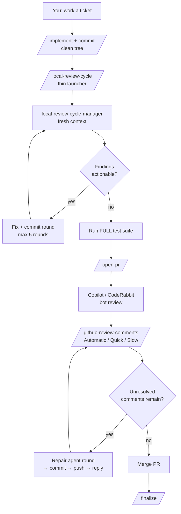
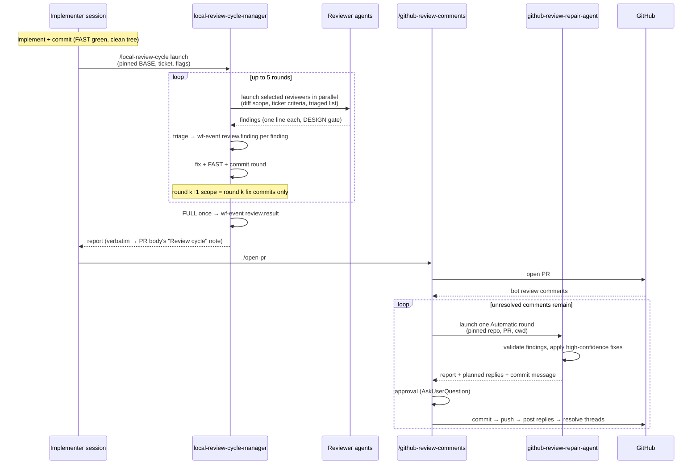

# Workflow & Review Architecture

State as of 2026-10. **Keep this current:** any change to the dotfiles workflow — commands, agents, skills, hooks, or the scripts behind them — must check whether this document needs updating.

## Flow: where review happens

```
implement → commit → /local-review-cycle → /open-pr → bot review → /github-review-comments → /finalize
```

Local review runs **before** the PR, on committed local fixes; `/github-review-comments` handles findings **after** the PR opens. The implementer never reviews its own work — orchestration itself runs in a fresh `local-review-cycle-manager` agent, so the implementing session's history never reaches the cycle either. Leaf reviewers stay fresh, read-only contexts.



## Files and why each is an agent, command, or skill

| File | Kind | Why |
|---|---|---|
| `commands/local-review-cycle.md` | Command | Thin launcher: verifies a clean tree, pins BASE/ticket/flags, launches the manager. No cycle logic. |
| `agents/local-review-cycle-manager.md` | Agent | Fresh context that orchestrates the whole cycle — selects reviewers, triages, fixes, commits each round locally; never pushes. |
| `skills/local-review-cycle-procedure/SKILL.md` | Skill | The cycle procedure (preflight, selection, triage, telemetry, report); loaded by the command and manager; not user-invocable. |
| `agents/{correctness,architecture,robustness,prompt}-reviewer.md` | Agent | Fresh, isolated context; read-only leaf reviewers. |
| `agents/{security,supply-chain}-reviewer.md` | Agent | Read-only security leaf reviewers — code-level vulnerabilities and build/config risk, selected by `Use when:` like the rest. |
| `skills/security-review-rubric/SKILL.md` | Skill | OWASP-anchored rubric preloaded into both security reviewers; usable directly for interactive checks. Separate from the built-in `/security-review`, which stays as the interactive whole-branch pass. |
| `agents/github-review-repair-agent.md` | Agent | Fresh context with edit tools; never commits/pushes/writes to GitHub. |
| `skills/reviewer-contract/SKILL.md` | Skill | Shared contract loaded into every reviewer; avoids per-agent duplication. |
| `skills/github-review-procedure/SKILL.md` | Skill | 3-mode procedure loaded by the command and repair agent; not user-invocable. |
| `commands/github-review-comments.md` | Command | Routes mode, launches agent, owns commits and GitHub writes. |
| `commands/prompt-audit.md` + `skills/prompt-review/` | Command + skill | Corpus-level prompt rubric; runs through `prompt-reviewer`. |
| `tools/wf-event.sh`, `tools/wf-report.sh`, `tools/lib/telemetry.sh` | Script | Telemetry: one event per triaged finding, one per cycle. |
| `tools/agent-phase.sh`, `github-review-state.sh` | Script | Statusline bookkeeping (`[REVIEW]` etc.); no review logic. |

## Patterns

1. **Risk-based selection.** Each reviewer's `description` ends with a `Use when:` clause; the orchestrator matches clauses against `git diff --name-only BASE...HEAD` and risk signals. Smallest set that covers the risks; no code reviewer on prompt-only diffs; deterministic issues go to formatter/linter/tests.
2. **Shrinking rounds.** Round 1 reviews `BASE...HEAD`; round k+1 reviews only round k's fix commits plus a correctness pass on touched files.
3. **Evidence bar + triage.** Findings need a credible failure path, test gap, or material design cost. Already-triaged findings pass forward; nothing is resurrected without new evidence.
4. **Gates and caps.** `DESIGN: unsound` halts before code changes; max 5 rounds; `FAST` per round, `FULL` once at finish; `--confirm-commits` is opt-in hold-for-review — by default the manager commits every round and human review happens on the PR.
5. **Isolation of side effects.** Reviewers read-only; repair agent edits only; commands own GitHub writes. The cycle manager is the deliberate exception: it owns the working-tree edits, round commits, telemetry and statusline during the cycle — but never pushes or writes to GitHub. Planned GitHub replies are posted only after the parent pushes.
6. **Measured.** Every triaged finding → `wf-event.sh review.finding` (with validity and an overlap key); cycle end → `review.result`. `wf-report.sh` shows which reviewers earn their tokens: valid/rejected/partial counts, overlap between reviewers, and rounds by reviewer mix.

## Commands: what to use when

| Situation | Command |
|---|---|
| Non-trivial change committed, pre-PR | `/local-review-cycle` (auto-invoked by CLAUDE.md after ticket implementation; launches `local-review-cycle-manager`) |
| PR opened, bot comments arrived | `/github-review-comments` → Automatic (agent round), Quick (one agent turn), Slow (ask me per comment) |
| Review of the prompt corpus itself | `/prompt-audit`, `/prompt-review` |
| Merged | `/finalize` |

## Agent invocation sequence



## Ownership and output visibility

```mermaid
flowchart LR
    subgraph Parent[Implementer session]
        direction TB
        C1[Owns: implementation edits and commits,<br/>PR body, GitHub writes, push]
    end
    subgraph CycleMgr[local-review-cycle-manager — sonnet]
        M1[Owns: cycle edits, round commits,<br/>telemetry events, statusline]
    end
    subgraph LeafReview[Leaf reviewers — read-only]
        L1[correctness-reviewer]
        L2[architecture-reviewer]
        L3[robustness-reviewer]
        L4[prompt-reviewer]
        L5[security-reviewer]
        L6[supply-chain-reviewer]
    end
    subgraph Repair[github-review-repair-agent — edits only]
        R1[Owns: working-tree edits,<br/>planned replies, proposed commit message]
    end
    Parent -->|/local-review-cycle: pinned BASE,<br/>ticket, flags| CycleMgr
    CycleMgr -->|report only,<br/>never pushes| Parent
    CycleMgr -->|launch: diff scope,<br/>criteria, triaged list| LeafReview
    LeafReview -->|findings only,<br/>no edits| CycleMgr
    Parent -->|launch: pinned repo/PR/cwd| Repair
    Repair -->|report + planned actions,<br/>never commits/pushes/GitHub| Parent
    Parent -->|posts replies only<br/>after push| GitHub[GitHub PR]
    Contract[reviewer-contract skill<br/>preloaded into every reviewer] -.-> LeafReview
    Contract -.-> Repair
```



Key invariant: outputs always flow **up**; the parent session owns every push and GitHub write. The cycle manager is the deliberate exception that owns commits and working-tree edits during its cycle — it still never pushes, writes to GitHub, or rewrites history. Children never talk to each other or to GitHub.

## Machine- and project-specific extensions

- **Machine:** machine behavior lives in templates and `is_*` data, never in agent bodies. The cycle command itself is machine-independent — `--confirm-commits` is opt-in per invocation on every machine.
- **Project reviewers:** agent-format file ending in a `Use when:` clause, in the repo's `.claude/agents/` (precedence over global); reference it from the project's `CLAUDE.md`.
- **Personal, work-machine reviewers for shared repos:** `docs/local/reviewers/*.md` — globally gitignored, symlinked into every worktree by `wm`. No work content in dotfiles. New personal agents default to the per-project overlay (`~/.config/project-overlays/<owner>/<repo>/claude/`, keyed by the origin remote), which also holds governor.md, kickoff preambles, and conf keys; `docs/local/` stays for content tied to this checkout's tree — scratch notes, temporary docs, throwaway experiments. Rule of thumb: a fresh clone needs it → overlay; only this checkout → `docs/local/`.
- **New reviewer:** follow `reviewer-contract`'s authoring convention and cite it from project docs; the orchestrator must never invent reviewers mid-cycle.

## Non-Claude hosts (cloud agents)

Codex (later Gemini) runs the command files in `dot_claude/commands/` directly; nothing is restated. `tools/cloud-workflow-bootstrap.sh` fetches the repo at one commit, and `workflow/adapters/<host>.md` maps the Claude-only constructs those commands use (slash commands, MCP, session labels, agent view, review options) to host behavior or a stop-and-report. `tools/cloud-workflow-adapter.test.sh` fails when a covered command gains or drops a construct on its known list without the adapter changing, so editing `start.md` or `open-pr.md` means updating the adapter's map in the same PR. v1 covers `/start` and `/open-pr` only; the independent review stage is not ported, so cloud PRs say `Independent review: not performed`. Details: `docs/cloud-workflow.md`.
